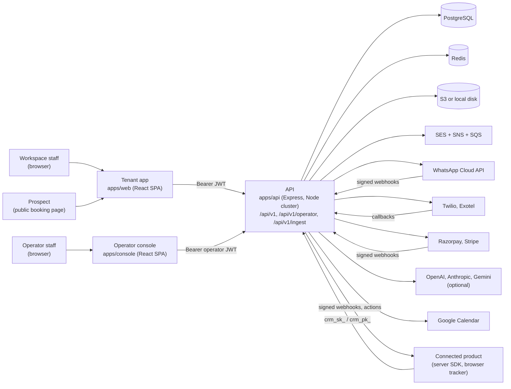
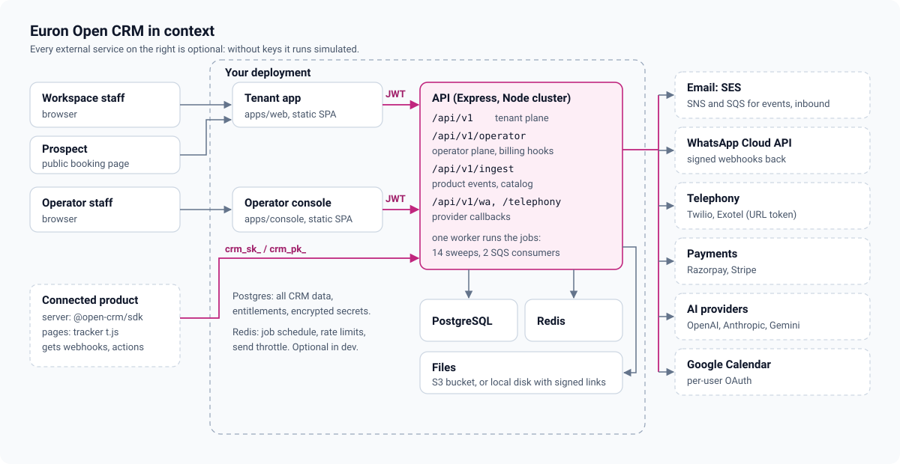
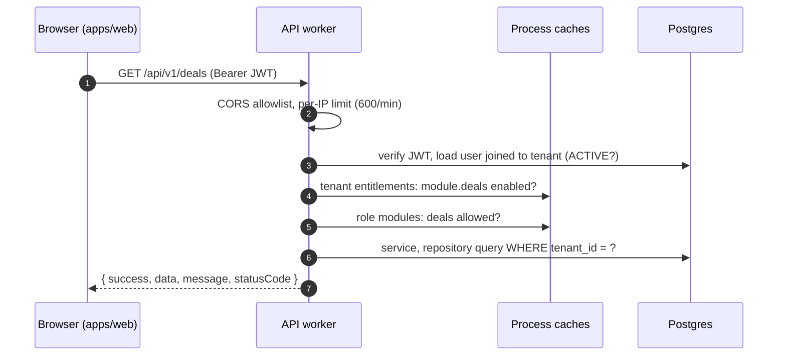
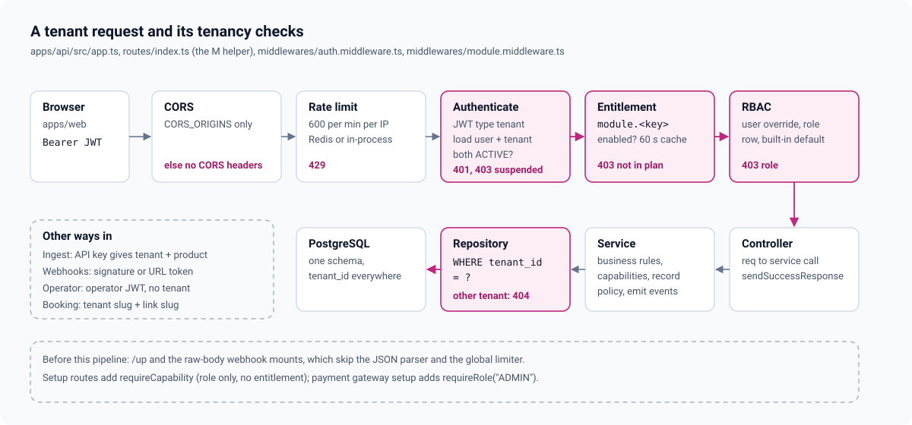
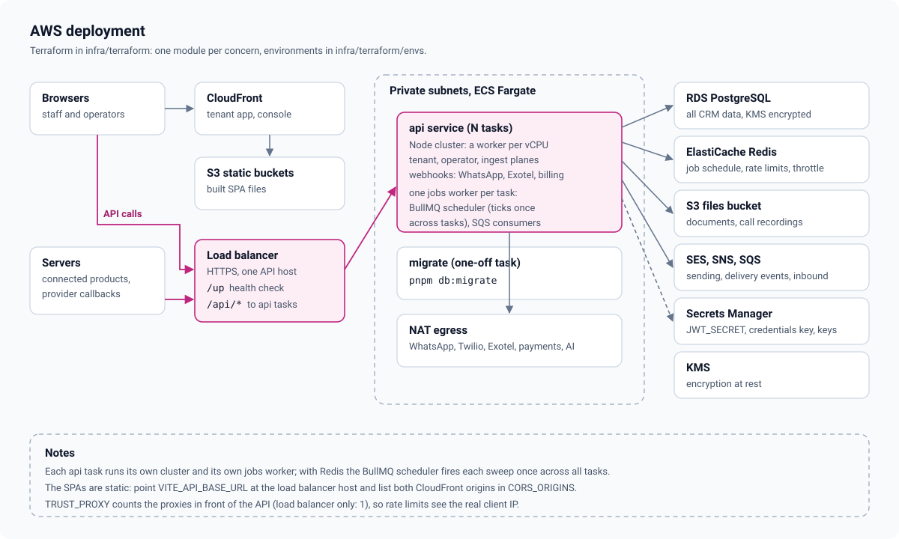

# High-level design

Euron Open CRM is a self-hosted, multi-tenant CRM. An operator runs one deployment and
sells workspaces (tenants) on plans. Each workspace gets leads, contacts, accounts, a deal
pipeline, a unified inbox over email and WhatsApp, campaigns, tickets and a knowledge base,
a calendar with public booking pages, no-code workflows, telephony, an AI copilot and a sales
agent, invoices and payment links, and a product-integration platform that turns what people
do inside the tenant's own software into signals on the lead record.

Paths are relative to the repository root.

| Topic | Page |
| --- | --- |
| Modules, layers, jobs and the request pipeline in code | [LLD.md](LLD.md) |
| Every table, grouped by domain | [data-model.md](data-model.md) |
| Tenants, plans, the entitlement snapshot and limits | [multi-tenancy-and-entitlements.md](multi-tenancy-and-entitlements.md) |
| Roles, custom roles, per-user overrides, visible modules | [rbac.md](rbac.md) |
| Domain events, workflows and actions | [automation-engine.md](automation-engine.md) |
| Connected products: ingest, identity, engagement, catalog, webhooks | [product-integration.md](product-integration.md) |
| Email, WhatsApp and telephony | [channels.md](channels.md) |
| The operator charging tenants for their plan | [platform-billing.md](platform-billing.md) |
| Copilot, sales agent, scoring and the offline provider | [ai.md](ai.md) |
| Security controls and known gaps | [security.md](security.md) |
| STRIDE analysis and residual risks | [threat-model.md](threat-model.md) |
| Decisions and their trade-offs | [adr/](adr/README.md) |

## 1. System context

## 2. What runs

| Process | Code | Does |
| --- | --- | --- |
| API | [`apps/api/src/index.ts`](../../apps/api/src/index.ts), [`apps/api/src/app.ts`](../../apps/api/src/app.ts) | One Node cluster: the primary forks one worker per CPU in production (one in development). Every worker serves HTTP. Exactly one worker is forked with `RUN_JOBS=true` and also runs the background jobs; if it dies, its replacement keeps that role |
| Background jobs | [`apps/api/src/jobs`](../../apps/api/src/jobs) | Fourteen recurring sweeps listed in [`registry.ts`](../../apps/api/src/jobs/registry.ts) on a BullMQ job scheduler when Redis is configured, `setInterval` timers otherwise, plus two long-poll SQS consumers for SES delivery events and inbound mail |
| Tenant app | [`apps/web`](../../apps/web) | The workspace SPA (React 19, Vite, TanStack Query, Zustand). Navigation is driven by the `modules` list the API returns at sign-in |
| Operator console | [`apps/console`](../../apps/console) | The operator SPA: plans, tenants, subscriptions, transactions, metrics, operator users, audit |
| SDK | [`packages/sdk`](../../packages/sdk) | `@open-crm/sdk`, a server-side client for the ingest API |
| Migrations | [`db/migrate.ts`](../../db/migrate.ts) | Forward-only SQL runner under an advisory lock ([ADR 0004](adr/0004-sql-migrations-prisma-types-only.md)) |

The API keeps no session state. Shared state is in Postgres; Redis holds the job schedule,
rate-limit windows, the email send throttle and resolver caches. Two caches live in process
memory per worker: tenant entitlements and role definitions, each for up to 60 seconds
([multi-tenancy-and-entitlements.md](multi-tenancy-and-entitlements.md), [rbac.md](rbac.md)).

## 3. Three planes on one API

| Plane | Prefix | Callers | Authentication |
| --- | --- | --- | --- |
| Tenant | `/api/v1/*` | `apps/web` | Tenant JWT (`type: "tenant"`), then the entitlement gate and RBAC per module |
| Operator | `/api/v1/operator/*` | `apps/console` | Operator JWT (`type: "operator"`); plan, tenant and operator writes need `SUPERADMIN` |
| Product ingest | `/api/v1/ingest/*` | Connected products | Workspace API key: `crm_sk_` (server) or `crm_pk_` (browser, origin locked) |

Provider callbacks have their own mounts, ahead of the JSON parser so signatures can be
checked over the raw body: WhatsApp at `/api/v1/wa/webhooks`, Exotel at
`/api/v1/telephony/webhooks/exotel`, platform billing at `/api/v1/operator/webhooks`
([`app.ts`](../../apps/api/src/app.ts)). Public tenant routes are sign-in, unsubscribe,
the Google OAuth callback and the public booking API ([`routes/index.ts`](../../apps/api/src/routes/index.ts)).

## 4. One tenant request

Details in [LLD.md](LLD.md#3-the-request-pipeline).

## 5. Tenancy and entitlements

One database, one schema, a `tenant_id` column on every tenant table, and every repository
query filters on it ([ADR 0002](adr/0002-multi-tenant-shared-schema.md)). Plans belong to
the operator. When a tenant is put on a plan, the plan's modules and limits are copied into
`tenant_entitlements`; the runtime reads only that table, never `plans`
([ADR 0003](adr/0003-entitlements-first.md)). A module is reachable when the tenant is
entitled to it and the user's role grants it; the sign-in response carries the intersection
so the SPA never renders a page the API would refuse ([rbac.md](rbac.md)).

## 6. Events

Two event streams drive the system ([events-and-automation.svg](../assets/diagrams/events-and-automation.svg)):

- **Domain events** (`lead.created`, `deal.won`, `ticket.created`, ...) are emitted by
  services. `engineService.emit` queues outbound webhook deliveries for subscribed endpoints
  and runs every active workflow of that tenant whose trigger matches, logging each run in
  `automation_runs` ([automation-engine.md](automation-engine.md)).
- **Product events** arrive through `/api/v1/ingest`. Each is resolved to a person through
  the identity graph, stored in `activity_events`, folded into an engagement profile with an
  intent score, and can fire product triggers such as `product.high_intent`
  ([product-integration.md](product-integration.md)).

## 7. Providers

Every external provider is optional. With no keys, or with its `*_SIMULATE` flag, a channel
runs simulated: messages are recorded, nothing leaves the deployment
([ADR 0006](adr/0006-simulated-providers-for-local-and-tests.md)). Tenants can bring their
own WhatsApp, Twilio, Exotel, Razorpay and Stripe accounts and email sending domains; their
secrets are encrypted with AES-256-GCM under `CREDENTIALS_ENCRYPTION_KEY` and never returned
([ADR 0005](adr/0005-byo-provider-credentials-encrypted.md)). How to switch each one on:
[../guides/connect-providers.md](../guides/connect-providers.md).

## 8. Where data lives

| Data | Where | Notes |
| --- | --- | --- |
| Every CRM record, entitlements, roles, audit, provider credentials (encrypted) | Postgres | 72 tables in [`db/migrations/0001_init.sql`](../../db/migrations/0001_init.sql) |
| Lead documents, call recordings | S3 bucket `AWS_S3_BUCKET`, or local disk under `LOCAL_STORAGE_DIR` | Downloads use short-lived links: presigned S3 URLs, or HMAC-signed `/local-files/...` links ([`storage.service.ts`](../../apps/api/src/services/storage.service.ts)) |
| Job schedule, rate-limit windows, send throttle | Redis | All rebuildable. Without `REDIS_URL` the API falls back to in-process timers and windows |
| Entitlement and role caches | Process memory | Up to 60 seconds per worker |
| Session token | The browser's `localStorage` (Zustand `persist`, keys `crm-auth` and `operator-auth`) | See [security.md](security.md#11-known-gaps) |

## 9. Deployment

The AWS shape: API tasks on ECS Fargate behind an Application Load Balancer, the two SPAs
as static files on S3 behind CloudFront, RDS PostgreSQL, ElastiCache Redis, an S3 bucket for
files, SES with SNS and SQS for delivery events and inbound mail, Secrets Manager for the
secrets and KMS for encryption at rest. The Terraform lives in
[`infra/terraform`](../../infra/terraform).

Each API task runs its own cluster and therefore its own jobs worker. With Redis configured,
BullMQ's job scheduler fires each tick once across all tasks; without Redis every task runs
every sweep on its own timers, so production should always set `REDIS_URL`.

AWS clients use static keys when they are set and otherwise the default AWS credential chain,
so on ECS the task role is enough: `AWS_S3_ACCESS_KEY` and `AWS_S3_SECRET_KEY` for S3, and
`AWS_SES_ACCESS_KEY` and `AWS_SES_SECRET_KEY` for SES, SNS and SQS
([`utils/aws.ts`](../../apps/api/src/utils/aws.ts)). `AWS_ENDPOINT_URL` points every client at
an emulator.

## 10. Not in this release

AI voice agent calls, AI-calling providers, journeys (drip sequences), the LMS module and the
simulated voice page were removed and are roadmap items, not features. Some columns they used
are still in the schema (for example `voice_calls.engine_session_id`, `agenda_id`,
`brief_context`); nothing reads them. The `support` and `knowledge` agents exist in the API
but are hidden in the tenant app ([ai.md](ai.md)).
