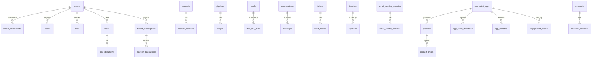

# Data model

The schema is defined in [`apps/api/prisma/schema.prisma`](../../apps/api/prisma/schema.prisma)
and applied as SQL from [`db/migrations/0001_init.sql`](../../db/migrations/0001_init.sql) by
[`db/migrate.ts`](../../db/migrate.ts). Prisma only generates the Kysely types in
[`apps/api/src/db/types.ts`](../../apps/api/src/db/types.ts) and
[`enums.ts`](../../apps/api/src/db/enums.ts); it never runs at runtime or applies migrations
([ADR 0004](adr/0004-sql-migrations-prisma-types-only.md)). 72 tables, 40 enums.

## Conventions

- Primary keys are ULIDs stored as `text`, minted in repositories.
- Every tenant table has `tenant_id` with a foreign key to `tenants` (`ON DELETE CASCADE`),
  and its indexes lead with `tenant_id` ([ADR 0002](adr/0002-multi-tenant-shared-schema.md)).
  The only tables without one are the operator's: `operator_users`, `plans`,
  `plan_gateway_refs`, `platform_webhook_events`, and `operator_audit_logs` (nullable).
- Timestamps are `timestamp(3)` without time zone, always written and read as UTC
  ([LLD.md](LLD.md#time)).
- Flexible attributes (tags, socials, permissions, actions, payloads) are `jsonb`.
- Most money columns are integer rupee amounts (`deals.value`, `invoices.amount`,
  `plans.price_monthly`). The product catalog and anything derived from it is in integer minor
  units with a `_minor` suffix ([ADR 0008](adr/0008-minor-units-for-catalog-money.md)).
- Provider secrets are in columns named `*_encrypted` (or `credentials` and `secret` holding
  sealed values), encrypted with AES-256-GCM ([ADR 0005](adr/0005-byo-provider-credentials-encrypted.md)).
- Some status columns are free strings validated in code rather than enums (for example
  `connected_apps.status`, `agent_outreach.status`, `webhook_deliveries.status`), so a new
  value needs no migration.

Only the relations declared in the schema are foreign keys. References such as
`deals.lead_id`, `deals.stage_id`, `activities.owner_id` or `products.app_id` are plain columns
checked in services, not database constraints.

## Operator plane

| Table | Holds | Notes |
| --- | --- | --- |
| `operator_users` | Operator console accounts | `role` is `SUPERADMIN` or `OPERATOR`; `status` from `user_status` |
| `plans` | Sellable plans | `key` unique; `modules` and `limits` as JSON; `price_monthly` and `currency`. Read only by the operator plane ([ADR 0003](adr/0003-entitlements-first.md)) |
| `operator_audit_logs` | Operator actions | `action`, `category`, optional `tenant_id`, `summary`, `metadata` |

## Platform billing

The operator charging tenants for their plan ([platform-billing.md](platform-billing.md)).

| Table | Holds | Notes |
| --- | --- | --- |
| `tenant_subscriptions` | One live subscription per tenant, history kept | `subscription_status` (`PENDING`, `ACTIVE`, `PAST_DUE`, `CANCELED`, `EXPIRED`, `PAUSED`, `GRANDFATHERED`), `billing_interval` (`MONTHLY`, `ANNUAL`), `billing_mode` (`AUTO`, `MANUAL`), period dates, `grace_until`, gateway ids |
| `platform_transactions` | Every charge, attempt and refund | `platform_txn_status`, `platform_txn_kind` (`CYCLE`, `SETUP`, `PRORATION`, `REFUND`); `gateway_invoice_id` unique |
| `plan_gateway_refs` | Plan and interval to the gateway's plan or price id | Unique on `(plan_key, gateway, billing_interval)` |
| `platform_webhook_events` | Inbound billing webhooks | `event_id` unique: the idempotency key |

## Tenancy and access

| Table | Holds | Notes |
| --- | --- | --- |
| `tenants` | Workspaces | `slug` unique, `plan_key`, `brand_color`, `status` (`ACTIVE`, `SUSPENDED`, `CLOSED`), `config` JSON, `email_sending_status` |
| `tenant_entitlements` | What the tenant may use | Unique `(tenant_id, code)`; `code` is `module.<key>` or `limit.<name>`, `enabled`, `limit_value` (NULL = no cap), `source` (`PLAN`, `ADMIN`) ([multi-tenancy-and-entitlements.md](multi-tenancy-and-entitlements.md)) |
| `users` | Workspace staff | Unique `(tenant_id, email)`; `role` is a string (a built-in key or a custom role key); `permissions` JSON is the per-user override; `available_for_calls` for inbound routing ([rbac.md](rbac.md)) |
| `roles` | Custom roles and per-tenant overrides of built-in roles | Unique `(tenant_id, key)`; `builtin=true` rows override a built-in role's module set |
| `saved_views` | A user's saved list filters | Per `resource` |
| `notifications` | In-app notifications | Written fire-and-forget by `engineService.notify` |
| `reminders` | Personal reminders | `due_date` is a string date |
| `audit_logs` | Tenant audit trail | `action`, `entity_type`, `entity_id`, `meta`. Written fire-and-forget ([automation-engine.md](automation-engine.md)) |
| `files` | Uploaded file metadata | `bucket`, `key`, `storage` (`S3`, `LOCAL`), polymorphic `entity_type` and `entity_id` |

## Sales

| Table | Holds | Notes |
| --- | --- | --- |
| `leads` | Inbound and outbound leads | `status` (`lead_status`), `owner_id`, `tags`, `socials`, score columns (`score_total`, `score_grade` `HOT`/`WARM`/`COLD`, `score_breakdown`, `scored_at`) stored at write time, `external_id` and `external_source` from ingest, `custom_fields` bag |
| `lead_documents` | Documents attached to a lead | `file_key` into storage |
| `contacts` | People | `lifecycle` (`LEAD`, `PROSPECT`, `CUSTOMER`), `account_id`, `converted_from_lead_id` |
| `accounts` | Companies | `departments` JSON |
| `account_contracts` | Contracts on an account | `deal_id` set when created from a won deal; also the idempotency key |
| `pipelines` | Deal pipelines | `is_default` |
| `stages` | Pipeline stages | `sort_order`, `won`, `lost` flags |
| `deals` | Opportunities | `value` (integer, currency `INR` by default), `stage_id`, `status` (`OPEN`, `WON`, `LOST`), `win_probability` and `health_score` stored at write time ([ai.md](ai.md)) |
| `deal_line_items` | Products on a deal | `unit_price_minor`, `discount_minor`, `total_minor`; `product_id` NULL for an ad-hoc line ([product-integration.md](product-integration.md)) |
| `activities` | The human sales timeline | `type` (`CALL`, `MEETING`, `DEMO`, `NOTE`, `EMAIL`, `TASK`), `ai_generated` |
| `tasks` | To-dos | `remind_daily` and `reminder_last_sent_at` (one email per day), `ai_generated` |
| `meetings` | Scheduled meetings | `mode` (`ONLINE`, `OFFLINE`), `status`, reminder stamps, `booking_link_id`, `external_event_id` for Google |
| `booking_links` | Public booking pages | Unique `(tenant_id, slug)`; a booking creates a lead |
| `calendar_connections` | A user's Google Calendar link | Unique `(tenant_id, user_id, provider)`; tokens encrypted |

## Conversations and marketing

| Table | Holds | Notes |
| --- | --- | --- |
| `conversations` | One thread per channel and person | `channel` (`WHATSAPP`, `EMAIL`, `SMS`, `TELEGRAM`, `CHAT`, `FACEBOOK`, `INSTAGRAM`, `VOICE`), `unread_count`, `last_preview` |
| `messages` | Messages in a conversation | `direction`, `simulated`, provider `external_id` for dedup and status, `status`, `sentiment`, `campaign_id` |
| `whatsapp_templates` | WhatsApp templates | Unique `(tenant_id, key)`; `language`, `variables`, `meta_id` from "Sync from Meta" |
| `email_templates` | Email templates | |
| `campaigns` | Bulk outreach and campaign ROI | `channel`, `audience_tag`, `template_params`, `recipients`, `sent`, `cost`, `revenue` |

The enum `channel` lists more channels than the code sends on. Email and WhatsApp are wired
end to end; calls are recorded in `voice_calls`, not as messages. The other values have no
provider behind them ([channels.md](channels.md)).

## Email infrastructure

| Table | Holds | Notes |
| --- | --- | --- |
| `email_sending_domains` | A tenant's own sending subdomain | `status` (`PENDING`, `VERIFIED`, `FAILED`, `DISABLED`), DKIM and MAIL FROM status, `dns_records` to publish |
| `email_sender_identities` | From addresses on a domain | Defaults per category (transactional, notification, marketing) |
| `email_messages` | Every email sent | `category`, `ses_message_id` unique, `status` (`QUEUED` to `SUPPRESSED`), delivery, bounce, complaint, open and click stamps, `idempotency_key` |
| `email_suppressions` | Addresses that must not receive mail | Unique `(tenant_id, email, category_scope)`; reason `HARD_BOUNCE`, `COMPLAINT`, `MANUAL_UNSUBSCRIBE`, `ADMIN_BLOCK`, `IMPORTED` |
| `email_reputation_events` | Sending status transitions | `from_status`, `to_status` (`ACTIVE`, `WARNING`, `THROTTLED`, `PAUSED`), `rates_snapshot` |
| `email_domain_health_checks` | Daily domain DNS snapshots | DKIM, MAIL FROM, SPF, DMARC |

## Telephony

| Table | Holds | Notes |
| --- | --- | --- |
| `tenant_telephony` | The tenant's Twilio or Exotel account | `provider`, `account_sid`, `auth_token_encrypted`, `api_key_encrypted`, `subdomain`, `from_number`, `webhook_token` (unique, the Exotel URL token) |
| `telephony_numbers` | The number pool | `kind` `MAIN` or `AGENT`, `assigned_user_id` ([../guides/telephony-exotel.md](../guides/telephony-exotel.md)) |
| `voice_calls` | Every call | Direction, numbers, `call_status`, `duration_sec`, `recording_url`, `transcript`, `summary`, sentiment, `action_items`, `twilio_call_sid` and `external_call_id` (unique). `engine_session_id`, `agenda_id`, `brief_context` and `cost_cents` are left from the removed AI voice agent and unused |

## Service

| Table | Holds | Notes |
| --- | --- | --- |
| `tickets` | Support tickets | `priority` (`URGENT` to `LOW`), `status` (`OPEN`, `PENDING`, `RESOLVED`, `CLOSED`), `sla_due_at`, `first_response_at`, `escalated`, `csat` |
| `ticket_replies` | Replies on a ticket | `is_ai` for AI-drafted replies |
| `sla_policies` | First-response and resolution hours | The default policy's `resolution_hours` sets `sla_due_at` on new tickets ([`tickets.service.ts`](../../apps/api/src/services/tickets.service.ts)) |
| `kb_articles` | Knowledge base | `status` (`DRAFT`, `PUBLISHED`, `ARCHIVED`), `tags`, `views`. Searched lexically for ticket AI-resolve ([ai.md](ai.md)) |

## Automation and AI

| Table | Holds | Notes |
| --- | --- | --- |
| `workflows` | Tenant automation rules | `trigger` (an event name), `actions` JSON, `active`, `run_count` ([automation-engine.md](automation-engine.md)) |
| `automation_runs` | One row per workflow run | `event` and the action `log` |
| `agent_runs` | Each AI agent run | `agent`, `summary`, `actions` |
| `agent_outreach` | Agent-drafted messages | `status` starts `DRAFT`; nothing is delivered until approved, then `SENT`; also the memory that stops re-messaging a lead |
| `agent_settings` | Per-tenant agent configuration | Unique `(tenant_id, agent)`; `enabled` and `auto_send` default to false, `score_threshold` 65, `daily_cap` 20 |
| `agent_enrollments` | A lead's progress through an agent sequence | `current_step`, `next_run_at`, `status` |

## Finance

A tenant billing its own customers. Not to be confused with platform billing above.

| Table | Holds | Notes |
| --- | --- | --- |
| `invoices` | Invoices | Unique `(tenant_id, number)`; `amount`, `tax`, `status` (`DRAFT`, `SENT`, `PAID`, `OVERDUE`, `REFUNDED`), `gateway` |
| `payments` | Payments against an invoice | `pay_url` (payment link), `gateway_payment_id`, `status` |
| `tenant_razorpay` | The tenant's own Razorpay account | `key_id` in clear (it is public in checkout), `key_secret_encrypted`, `status` |
| `tenant_stripe` | The tenant's own Stripe account | `secret_key_encrypted`, `status` |

## Integrations and channels setup

| Table | Holds | Notes |
| --- | --- | --- |
| `integrations` | Connected third-party services | Unique `(tenant_id, key)`; `credentials` JSON holds a sealed value |
| `webhooks` | Outbound webhook subscriptions | `url`, `event`, `secret` (sealed), `deliveries` |
| `webhook_deliveries` | Every outbound delivery attempt | `status` (`PENDING`, `SUCCEEDED`, `FAILED`, `EXHAUSTED`), `attempt`, `next_retry_at`, response code and body |
| `api_keys` | Workspace API keys | `key_hash` (SHA-256) unique, `key_prefix`, `scope` (`SECRET`, `PUBLISHABLE`), `app_id`, `revoked_at` |
| `lead_ingest_events` | Every inbound lead submission | Unique `(tenant_id, external_id)` for idempotency; `status` (`CREATED`, `DEDUPED`, `REJECTED`, `SPAM`) |
| `tenant_whatsapp` | The tenant's own WhatsApp Business account | `phone_number_id`, `waba_id`, `access_token_encrypted`, `app_secret_encrypted`, `registration_pin_encrypted`, `webhook_verify_token`, `connect_method` |

## Product integration

([product-integration.md](product-integration.md))

| Table | Holds | Notes |
| --- | --- | --- |
| `connected_apps` | A product the workspace wired up | Unique `(tenant_id, key)`; `status` (`ACTIVE`, `PAUSED`, `DISABLED`), `environment` (`LIVE`, `TEST`), `catalog_mode` (`PUSH`, `PULL`, `MANUAL`), `allowed_origins` for publishable keys, `actions_url`, `actions_secret` (encrypted), `actions_catalog`, `health` |
| `products` | The sellable catalog | Unique `(tenant_id, app_id, external_id)`; `source` `SYNCED` (owned by the product, read-only in the CRM) or `MANUAL`; `highlights`, `attributes`, `media` |
| `product_prices` | Price book entries | `amount_minor`, `compare_at_minor`, `currency`, `billing_period`, `is_default` |
| `product_offers` | Offers and coupons | A non-NULL `code` makes it a coupon; `discount_type` `PERCENT` or `FLAT` (minor units), window, `max_redemptions` |
| `app_event_definitions` | The event registry per app | Unique `(tenant_id, app_id, name)`; `review_status` `ACTIVE`, `NEEDS_REVIEW` (auto-registered, no scoring) or `IGNORED`; `intent_weight`, `is_high_intent` ([ADR 0007](adr/0007-unknown-events-accepted.md)) |
| `app_identities` | The identity graph | Unique `(tenant_id, app_id, identity_type, identity_value)`; types `EXTERNAL_USER_ID`, `EMAIL`, `PHONE`, `ANONYMOUS_ID`; points at a lead or contact |
| `engagement_profiles` | One rollup per person and app | Lifecycle stage, plan, MRR, 30-day counters, `intent_score` 0 to 100, `intent_band`, `intent_reasons`, abandoned cart, top products, product-defined `usage` |
| `activity_events` | Every product event | Unique `(tenant_id, idempotency_key)`; `status` `RECORDED`, `ORPHAN` or `REJECTED`; `anonymous_id`, `session_id`, `value_minor`. Kept apart from `activities` so telemetry never floods the human timeline |

## Enums

All 40 are in [`apps/api/src/db/enums.ts`](../../apps/api/src/db/enums.ts). The ones not named
in the tables above: `priority` (`HIGH`, `MEDIUM`, `LOW`), `task_status` (`OPEN`, `DONE`,
`CANCELLED`), `reminder_status` (`OPEN`, `DONE`), `message_direction` (`INBOUND`, `OUTBOUND`),
`conversation_status` (`OPEN`, `CLOSED`), `wa_template_category` (`MARKETING`, `ONBOARDING`,
`TRANSACTIONAL`), `wa_template_status` (`APPROVED`, `PENDING`, `REJECTED`), `campaign_status`
(`ACTIVE`, `PAUSED`, `COMPLETED`), `contract_status` (`ACTIVE`, `INACTIVE`, `EXPIRED`),
`payment_status` (`SUCCESS`, `FAILED`, `PENDING`, `REFUNDED`), `meeting_status` (`SCHEDULED`,
`CANCELLED`, `COMPLETED`), `email_identity_status` (`ACTIVE`, `ARCHIVED`), `telephony_status`
(`PENDING`, `ACTIVE`, `DISABLED`, also used by the Razorpay, Stripe and WhatsApp config tables).

## Changing the schema

Edit `schema.prisma`, generate the SQL for the change into a new
`db/migrations/NNNN_name.sql` (never edit an applied file: the runner checksums each one and
refuses a changed file), run `pnpm db:migrate`, then `pnpm --filter @open-crm/api gen:types`
to regenerate the Kysely types. Tests in `tests/mock` use a hand-maintained subset of the
schema in [`tests/mock-schema.ts`](../../apps/api/tests/mock-schema.ts), regenerated by
[`scripts/gen-mock-schema.ts`](../../apps/api/scripts/gen-mock-schema.ts) from a migrated
database.
