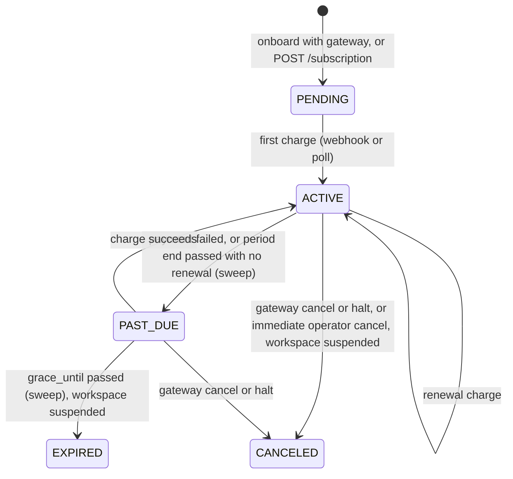

# Platform billing

How the operator charges tenants for their plan: subscriptions on the operator's own
Razorpay or Stripe account, signed webhooks, a payment poller, a dunning sweep and the
link between subscription state and a tenant's entitlements. Paths are relative to the
repository root.

This is not the tenant **finance** module. Finance (`invoices`, `payments`,
`tenant_razorpay`, `tenant_stripe`, [`apps/api/src/services/finance.service.ts`](../../apps/api/src/services/finance.service.ts))
is a tenant billing its own customers through its own gateway account. Platform billing
is the operator billing tenants, always on the operator's account from config, and lives
under `operator/` folders.

| Concern | Code |
| --- | --- |
| Orchestration (create, pay now, mode switch, cancel, sweep, poll, metrics) | [`apps/api/src/services/operator/billing.service.ts`](../../apps/api/src/services/operator/billing.service.ts) |
| Webhook transitions | [`apps/api/src/services/operator/billing-webhook.service.ts`](../../apps/api/src/services/operator/billing-webhook.service.ts) |
| Gateway seam (Razorpay Subscriptions, Stripe Billing, simulate) | [`apps/api/src/services/operator/platform-gateway.service.ts`](../../apps/api/src/services/operator/platform-gateway.service.ts) |
| Subscription state to entitlements | [`apps/api/src/services/operator/entitlements-sync.service.ts`](../../apps/api/src/services/operator/entitlements-sync.service.ts) |
| Onboarding with upfront payment | [`apps/api/src/services/operator/tenants.service.ts`](../../apps/api/src/services/operator/tenants.service.ts) |
| Operator routes | [`apps/api/src/routes/operator/tenants.route.ts`](../../apps/api/src/routes/operator/tenants.route.ts), [`billing.route.ts`](../../apps/api/src/routes/operator/billing.route.ts), [`webhooks.route.ts`](../../apps/api/src/routes/operator/webhooks.route.ts) |
| Tenant self-service routes | [`apps/api/src/routes/billing.route.ts`](../../apps/api/src/routes/billing.route.ts), [`apps/api/src/controllers/billing.controller.ts`](../../apps/api/src/controllers/billing.controller.ts) |
| Jobs | [`apps/api/src/jobs/platform-subscription-sweep.job.ts`](../../apps/api/src/jobs/platform-subscription-sweep.job.ts), [`apps/api/src/jobs/platform-payment-poll.job.ts`](../../apps/api/src/jobs/platform-payment-poll.job.ts) |
| Tests | [`apps/api/tests/operator/billing.test.ts`](../../apps/api/tests/operator/billing.test.ts), [`apps/api/tests/api/tenant-billing.test.ts`](../../apps/api/tests/api/tenant-billing.test.ts) |

## 1. Rules

- **Payment is upfront.** A tenant onboarded with a gateway is created `SUSPENDED` with a
  `PENDING` subscription, and becomes `ACTIVE` only on the first successful charge. There
  is no trial status.
- **Cancel or lapse suspends the whole workspace** (`tenants.status = SUSPENDED`). There is
  no free-tier downgrade.
- **Monthly only.** `billing_interval` has `ANNUAL`, but every code path asks for
  `MONTHLY`.
- **Tenants without a subscription are left alone.** A tenant onboarded without a gateway
  is active at once and never billed; the sweep and the entitlement sync skip any tenant
  with no `tenant_subscriptions` row. The seeded Northwind Academy and Acme Robotics
  workspaces are in this state ([`apps/api/scripts/seed.ts`](../../apps/api/scripts/seed.ts)
  creates no subscriptions).
- **Plans stay sales artifacts.** Subscription state decides `tenants.status` and whether
  the plan-sourced entitlement rows exist; it never edits a plan
  ([multi-tenancy-and-entitlements.md](multi-tenancy-and-entitlements.md)).

## 2. Tables

All four are in [`apps/api/prisma/schema.prisma`](../../apps/api/prisma/schema.prisma) and
[`db/migrations/0001_init.sql`](../../db/migrations/0001_init.sql).

| Table | Holds | Notable columns |
| --- | --- | --- |
| `tenant_subscriptions` | One row per subscription attempt; history kept | `plan_key`, `gateway` (`RAZORPAY` or `STRIPE`), `billing_mode` (`AUTO` or `MANUAL`), `status`, `gateway_customer_id`, `gateway_subscription_id` (unique), `checkout_url`, `checkout_ref`, `current_period_start`, `current_period_end`, `cancel_at_period_end`, `grace_until`, `amount`, `currency` |
| `platform_transactions` | The operator to tenant ledger: one row per charge, failed attempt or refund | `gateway_invoice_id` (unique, the de-dupe key), `gateway_payment_id`, `status` (`PENDING`, `PAID`, `FAILED`, `REFUNDED`), `kind` (`CYCLE`, `SETUP`, `PRORATION`, `REFUND`), `period_end`, `hosted_invoice_url`, `failure_reason` |
| `plan_gateway_refs` | Maps a plan and interval to the gateway's plan or price id | `plan_key`, `gateway`, `billing_interval`, `external_plan_id`, `amount`, `currency`; unique on the first three |
| `platform_webhook_events` | Idempotency and audit for inbound webhooks | `event_id` (unique), `event_type`, `status`, `processed_at` |

`subscription_status` is `PENDING`, `ACTIVE`, `PAST_DUE`, `CANCELED`, `EXPIRED`,
`PAUSED`, `GRANDFATHERED`. "Live" means `PENDING`, `ACTIVE` or `PAST_DUE`
(`LIVE_STATUSES` in [`apps/api/src/repositories/operator/subscriptions.repository.ts`](../../apps/api/src/repositories/operator/subscriptions.repository.ts)).
The "current" subscription is the newest row of any status.

Amounts in `plan_gateway_refs`, `tenant_subscriptions` and `platform_transactions` are
gateway minor units (paise for INR). `plans.price_monthly` is a display price in major
units: the seed writes `plan_gateway_refs.amount = price_monthly * 100`. A plan is
billable on a gateway only once its `plan_gateway_refs` row exists; the seed inserts
placeholder ids (`rzp_plan_growth`, `price_growth`) that must be replaced with real
Razorpay plan ids and Stripe price ids before charging anyone.

## 3. Billing modes

| Mode | What the gateway holds | How a cycle is paid |
| --- | --- | --- |
| `AUTO` | A Razorpay subscription or a Stripe Checkout session in `subscription` mode, with a mandate | The gateway charges each month and sends a webhook |
| `MANUAL` | Nothing recurring | A one-time Razorpay payment link or Stripe Checkout session per cycle, with reference `pmsub_<subscription id>`; each paid link extends the period by one month |

Switching modes ([`billing.service.ts`](../../apps/api/src/services/operator/billing.service.ts) `setMode`):

- **AUTO to MANUAL** cancels the gateway mandate and keeps access through the current
  period.
- **MANUAL to AUTO** creates a new mandate whose first charge is deferred to the paid
  period's end (Razorpay `start_at`, Stripe `subscription_data[trial_end]`), so time the
  tenant already paid for is not charged twice. It returns the authorization URL.

## 4. Lifecycle

### Onboarding with upfront payment

`POST /api/v1/operator/tenants` with an optional `gateway` and `billingMode`
([`tenants.service.ts`](../../apps/api/src/services/operator/tenants.service.ts) `onboard`):

1. Validates the plan and, when a gateway is given, that `plan_gateway_refs` has a
   `MONTHLY` row for it, before creating anything.
2. In one transaction: the tenant, the plan snapshot into `tenant_entitlements`, the first
   `ADMIN` user, and the default pipeline with its stages.
3. With a gateway: sets the tenant `SUSPENDED`, then `billingService.createForTenant`
   creates the gateway customer and subscription (or payment link) and stores a `PENDING`
   row with the hosted `checkout_url`. If that step fails the tenant row is deleted (the
   delete cascades), so onboarding is all or nothing.
4. Sends the welcome email (fire and forget). With a checkout URL it leads with "complete
   your subscription". The response carries `checkoutUrl` and `emailDispatched`.

Without a gateway the tenant is `ACTIVE` immediately and has no subscription.

### Webhooks

`POST /api/v1/operator/webhooks/razorpay` and `POST /api/v1/operator/webhooks/stripe` are
mounted in [`apps/api/src/app.ts`](../../apps/api/src/app.ts) before `express.json()`, with
`express.raw` (2 MB limit) so the signature is checked over the exact bytes. They carry no
operator JWT and are mounted before the global rate limiter.

| Step | Razorpay | Stripe |
| --- | --- | --- |
| Signature | HMAC-SHA256 of the raw body with `RAZORPAY_WEBHOOK_SECRET`, compared in constant time with `X-Razorpay-Signature` ([`razorpay.client.ts`](../../apps/api/src/services/razorpay.client.ts)) | HMAC-SHA256 of `t.body` with `STRIPE_WEBHOOK_SECRET` against `v1` in `Stripe-Signature`, constant time ([`stripe.client.ts`](../../apps/api/src/services/stripe.client.ts)) |
| Empty secret | Refused (`401`) | Refused (`401`) |
| Idempotency key | `rzp_` plus SHA-256 of the signed body (the `X-Razorpay-Event-Id` header is unsigned, so it is not used) | The event `id` |
| Answer | `200` processed or already processed, `400` bad JSON, `401` bad signature, `500` handler error | same |

`platform_webhook_events` is checked before applying and written only after success, so a
handler failure returns `500` and the gateway's retry applies it again.

| Event | Effect |
| --- | --- |
| Razorpay `subscription.charged`, Stripe `invoice.paid` | `PAID` transaction (de-duped by gateway invoice id), subscription `ACTIVE` with the new period end, `grace_until` and `checkout_url` cleared, tenant `ACTIVE`, entitlement sync |
| Stripe `checkout.session.completed` with a subscription | First AUTO activation: the session's `client_reference_id` (`<tenantId>-<ts>`) finds the tenant's live subscription, stores the Stripe subscription id, activates |
| Razorpay `payment_link.paid`, Stripe `checkout.session.completed` without a subscription | MANUAL renewal through the `pmsub_` reference: one `PAID` transaction, period end moved one month past the later of now and the current end |
| Razorpay `subscription.pending`, Stripe `invoice.payment_failed` | Subscription `PAST_DUE` with `grace_until = now + BILLING_GRACE_DAYS`; Stripe also records a `FAILED` transaction. Access is kept |
| Razorpay `subscription.halted` and `subscription.cancelled`, Stripe `customer.subscription.deleted` | Subscription `CANCELED`, tenant `SUSPENDED` at once, entitlement sync revokes the plan rows |
| Anything else | Recorded as processed, no change |

A MANUAL payment already recorded (same gateway invoice or payment id) only re-asserts
`ACTIVE` and never rolls the period again, so a replayed webhook or the poller overlapping a
webhook cannot grant a free month.

### Payment poll

`billing-payment-poll` runs every 30 seconds ([`apps/api/src/jobs/registry.ts`](../../apps/api/src/jobs/registry.ts)).
It fetches every MANUAL subscription in `PENDING` or `PAST_DUE` with an outstanding
`checkout_ref` and asks the gateway whether the link or session was paid
(`fetchPaymentStatus`). A paid one is activated through the same idempotent path as the
webhook. So MANUAL billing works without webhooks configured. AUTO billing does not: its
renewals and first activation arrive only by webhook.

### Dunning sweep

`billing-sweep` runs every hour (`billingService.sweep`, then
`reconcileEntitlements`). It looks at `ACTIVE` and `PAST_DUE` subscriptions with a known
period end:

- `ACTIVE` past `current_period_end` (no renewal arrived): `PAST_DUE` with a grace window
  of `BILLING_GRACE_DAYS` (3 by default).
- `PAST_DUE` past `grace_until`: `EXPIRED`, tenant `SUSPENDED`, plan entitlements revoked.
- `PAST_DUE` without `grace_until`: given one.

Then it runs the entitlement sync for every tenant that has ever had a subscription, which
repairs drift from a missed hook or a tenant set back to `ACTIVE` by hand.

### Cancel

`POST /api/v1/operator/tenants/:id/subscription/cancel` with `{ "atPeriodEnd": true }`
cancels at the gateway at cycle end and leaves the workspace live; the sweep suspends it
when the period lapses. Without it the cancel is immediate: subscription `CANCELED`,
tenant `SUSPENDED`, plan entitlements revoked.

## 5. Subscription state and entitlements

[`entitlements-sync.service.ts`](../../apps/api/src/services/operator/entitlements-sync.service.ts)
keeps the `source = PLAN` rows of `tenant_entitlements` in line with the current
subscription. It is called after every transition above and by the hourly sweep.

| Current subscription | Plan rows |
| --- | --- |
| None | Untouched (comp or manually managed tenant) |
| `PENDING`, `ACTIVE`, `PAST_DUE`, `GRANDFATHERED` | Kept; re-inserted from the tenant's plan if a previous lapse removed them |
| `CANCELED`, `EXPIRED`, `PAUSED` | Deleted |

Only `PLAN` rows are touched. An operator's `ADMIN` override survives both a lapse and a
reinstatement. So suspension has two legs: `tenants.status` blocks sign-in and every
authenticated request, and the missing entitlements stop module access even if someone
sets the tenant back to `ACTIVE` without a paid subscription. The sync never throws; a
failure is logged and the next call repairs it.

## 6. API surface

Operator plane (operator JWT; writes need `SUPERADMIN`, [`apps/api/src/middlewares/operator-auth.middleware.ts`](../../apps/api/src/middlewares/operator-auth.middleware.ts)):

| Method and path | Does |
| --- | --- |
| `GET /api/v1/operator/tenants/:id/subscription` | The current subscription |
| `POST /api/v1/operator/tenants/:id/subscription` | Start or replace a subscription: `{ gateway, planKey?, billingMode? }`. The previous live one is cancelled only after the new gateway object exists |
| `POST /api/v1/operator/tenants/:id/subscription/cancel` | `{ atPeriodEnd? }` |
| `GET /api/v1/operator/tenants/:id/transactions` | The tenant's ledger |
| `GET /api/v1/operator/billing/metrics` | MRR (sum of `amount` over `ACTIVE` subscriptions), counts by status, renewals due in 7 days |

Tenant plane (tenant JWT plus the RBAC-only `billing` capability, which only `ADMIN`
holds among the built-in roles; the tenant is always the caller's, never a URL parameter):

| Method and path | Does |
| --- | --- |
| `GET /api/v1/billing` | Current subscription and its plan |
| `GET /api/v1/billing/transactions` | The ledger |
| `POST /api/v1/billing/pay` | MANUAL: a fresh payment link for the next cycle. AUTO and `PENDING`: the stored mandate URL. AUTO and active: `400`, nothing to pay |
| `POST /api/v1/billing/mode` | `{ mode: "AUTO" \| "MANUAL" }` |

The operator console shows this on the tenant detail page and a Billing overview
([`apps/console/src/pages/billing.tsx`](../../apps/console/src/pages/billing.tsx)); the
workspace app has a Billing page under Administration
([`apps/web/src/pages/billing.tsx`](../../apps/web/src/pages/billing.tsx)).

## 7. Configuration

From [`apps/api/src/config/index.ts`](../../apps/api/src/config/index.ts):

| Variable | Default | Effect |
| --- | --- | --- |
| `RAZORPAY_KEY_ID`, `RAZORPAY_KEY_SECRET` | blank | The operator's Razorpay account. The same variables are the platform default for tenant finance |
| `STRIPE_SECRET_KEY` | blank | The operator's Stripe account |
| `RAZORPAY_WEBHOOK_SECRET`, `STRIPE_WEBHOOK_SECRET` | blank | Verify the platform webhooks. Blank means every webhook is refused |
| `BILLING_SIMULATE` | `false` in config, `true` in [`apps/api/.env.example`](../../apps/api/.env.example) | Canned customer, subscription and link ids, no network. Always on under tests (`NODE_ENV=test` or Vitest) |
| `BILLING_GRACE_DAYS` | `3` | Grace window for `PAST_DUE` |
| `BILLING_RETURN_URL` | `{CRM_APP_URL}/login` | Where the hosted checkout returns. The login page, because a first-time admin pays before they can sign in |

Turning simulation into real billing: [../guides/connect-providers.md](../guides/connect-providers.md).

## 8. Known limitations

- **Simulated checkout never completes by itself.** With `BILLING_SIMULATE` the checkout
  URL is `BILLING_RETURN_URL?sim_sub=...` and the poller reports simulated links as unpaid,
  so a tenant onboarded with a gateway stays `SUSPENDED` until a signed webhook is posted
  (which is what the tests do) or an operator sets it `ACTIVE`.
- **A suspended tenant cannot reach its own Billing page.** Every tenant route, `/billing`
  included, rejects a `SUSPENDED` workspace ([`apps/api/src/middlewares/auth.middleware.ts`](../../apps/api/src/middlewares/auth.middleware.ts)).
  Recovery is through the checkout URL in the welcome email or an operator.
- **No grandfathering tool.** `GRANDFATHERED` is honoured everywhere (never swept, keeps
  entitlements), but nothing in this repository creates such rows.
- **Starting a subscription on another plan does not change the tenant's plan.**
  `POST /subscription` with a different `planKey` bills that plan but leaves
  `tenants.plan_key` and the entitlement snapshot as they were; change the plan with
  `PUT /api/v1/operator/tenants/:id`.
- **Stripe timestamps are not checked.** The `t` in `Stripe-Signature` is signed but not
  compared with the clock, so replay protection rests on event-id de-duplication.
- **Razorpay failure events.** Only `subscription.pending` moves a Razorpay subscription
  to `PAST_DUE`; no `FAILED` transaction is recorded for it.
- **Metrics assume one currency.** `GET /billing/metrics` reports `currency: "INR"` and
  sums amounts across subscriptions without converting.
- **Refunds and proration** exist in the `platform_txn_kind` enum but no code writes them.
